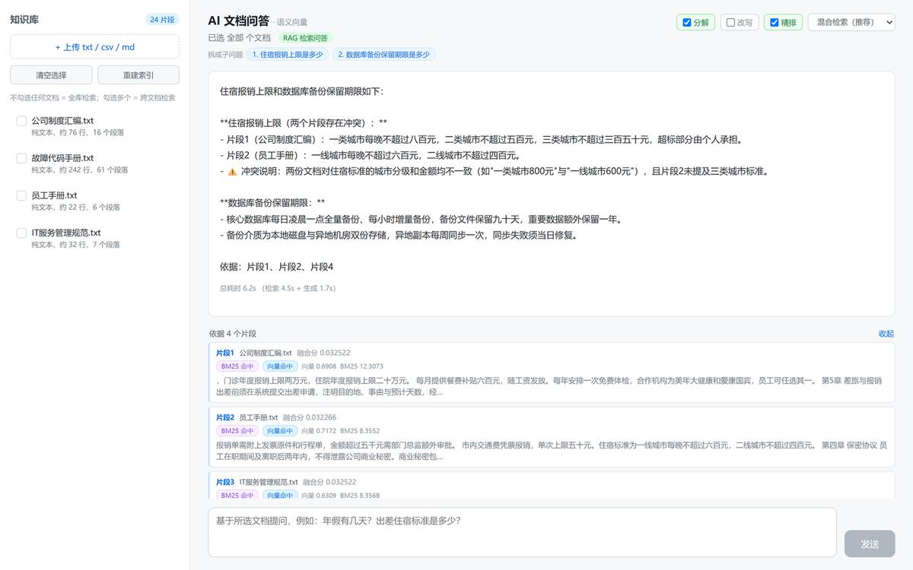
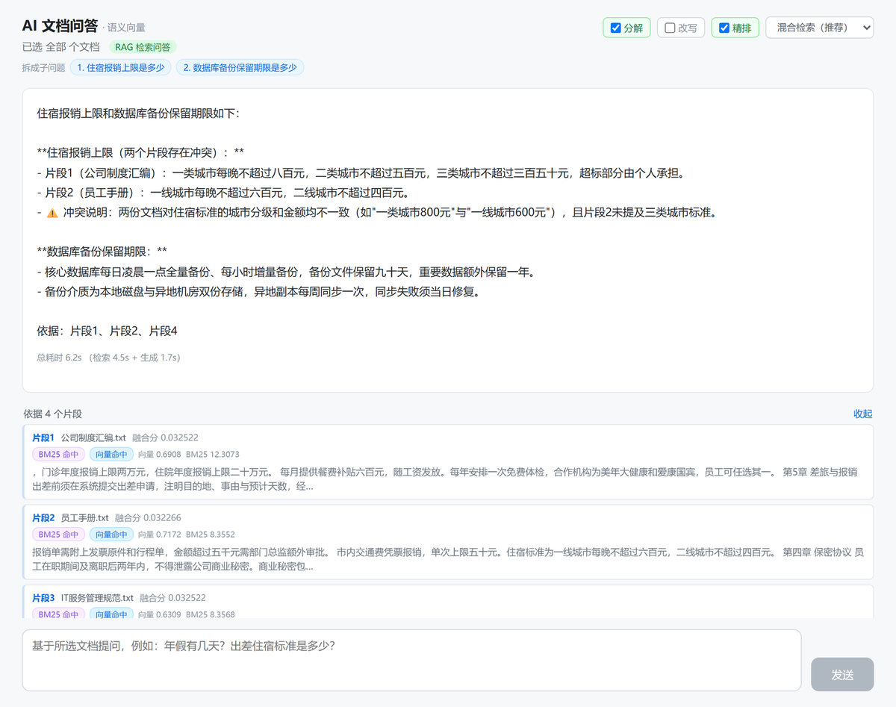

# AI 文档智能处理平台

Vue3 + FastAPI + MySQL 的前后端分离全栈项目。核心能力：上传 txt/csv/md/docx 文档 → 后端解析清洗入库 → **子问题分解 + 混合检索（向量 + BM25 + RRF）+ Cross-encoder 精排** → 基于检索到的片段做问答，**SSE 流式返回**。

技术栈刻意选的都是常见基础组件：前端 Vue3、后端 Python/FastAPI、MySQL、Linux 部署，只新增 FastAPI 一个框架。



> 这张图里能同时看到三个设计：**把「住宿上限 + 备份期限」拆成两个子问题分别检索**（顶部蓝色标签）、
> **发现两份文档标准冲突并如实指出**（而不是随便挑一个数）、**标注依据了哪几个片段**。
> 底部「总耗时 6.2s（检索 4.5s + 生成 1.7s）」是把检索和生成分开计时的结果 —— 只报生成时间会低估用户的真实等待。

## 功能

- 上传 `.txt` / `.csv` / `.md` / **`.docx`**，自动探测编码（UTF-8 / GBK / GB18030…）、自动识别分隔符（逗号 / 分号 / Tab / 竖线）
- **Word 解析**：段落按阅读顺序提取，**表格单独转成 Markdown 表格**（实验报告的数据大多在表格里，只读段落会全丢）
- **批量导入**：一条命令导入整个目录，带三层安全过滤（扩展名白名单 / 敏感词黑名单 / 临时文件识别）
- CSV 自动识别表头并转成 Markdown 表格喂给大模型，表格结构保留
- MySQL 存文档元信息、全文内容、问答记录、切片与向量
- **子问题分解**：多意图问题拆开分别检索，跨文档题 5/8 → 8/8（**默认开启**）
- **查询改写**：小模型把问题改写成 3 个不同角度的查询，跨查询 RRF 融合，结果带缓存（默认关闭，见实测结论）
- **混合检索**：语义向量 + BM25 关键词，用 RRF 融合，可切换单路对比
- **Cross-encoder 精排**：粗排召回 20 → bge-reranker 精排，输入截断 400 字控延迟（**默认开启**）
- **RAG 检索问答**：切片 → 检索 → 片段拼上下文，回答标注引用来源
- **多文档检索**：可勾选多篇跨文档提问，不选则全库检索
- **SSE 流式问答**，网页打字机效果，逐 token 渲染
- 文档列表、预览、删除、问答历史、切片查看、一键重建索引

### 每条引用都标注了召回来源和分数



调检索效果时，光看「答案对不对」不够，得知道**这条片段是谁召回的、排第几**：

- **向量命中 / BM25 命中** —— 两路都命中的片段通常最可靠；只有一路命中时就要看是哪一路
- **精排分数** —— cross-encoder 对这一对 (问题, 片段) 的打分，**出现负分是正常的**，说明模型认为不相关
- **融合分** —— RRF 融合后的排序依据，只在同一次查询内可比，跨查询不可比

这套标注是做评估时顺手加的：没有它，就分不清「检索没召回」和「召回了但排序错了」。

## 改进跨文档检索：从 5/8 到 8/8

前面的评估明确指出了瓶颈：**CROSS 跨文档题只有 5/8，而且精排完全帮不上忙**（5→5）。

根因不是排序不好，而是 **top_k 被单篇文档占满**。实测问「Vue 的表单绑定和 Linux 的创建目录分别怎么做」时，前 20 个候选里 8 条是 Vue 文档，含 `mkdir` 的片段排在**第 6 名**，而 top_k=5 全是 Vue —— 模型只能答一半。

### 试错：文档配额（MMR 简化版）行不通

先做的是「按文档分组保底」，让每篇文档至少进 1 条。**失败了**：

| 配置 | top-5 覆盖文档数 | 命中 mkdir |
|---|---|---|
| min_docs=2, 单篇≤3 | 2 篇（都是 Vue） | ❌ |
| min_docs=3, 单篇≤2 | 3 篇（都是 Vue） | ❌ |
| min_docs=4, 单篇≤2 | 4 篇 | ✅（碰巧） |

原因：配额只能保证「选了几篇**不同**文档」，保证不了「覆盖了几个**意图**」。候选池前几名文档全是 Vue，强制多样性也只是在多篇 Vue 里打转。而要 min_docs=4 才碰巧捞到 Linux 文档 —— 那种设置下单文档题会被灌进 3 篇无关文档。

**代码保留但默认关闭**（`DIVERSITY_MIN_DOCS=1`），作为对照记在注释里。

### 生效方案：子问题分解 + 分别检索

真正的解法是把「一个查询两个意图」拆开：

```
「Vue 的表单绑定和 Linux 的创建目录分别怎么做」
    ↓ 小模型拆分
["Vue 表单双向绑定怎么做", "Linux 创建目录用什么命令"]
    ↓ 各自检索，各保底贡献 1 条
Vue 文档 + Linux 文档（含 mkdir）都进 top-5
```

| 配置 | CROSS Hit@5 |
|---|---|
| 仅向量 | 3/8 |
| 仅 BM25 | 7/8 |
| 混合 | 6/8 |
| 混合 + 精排 | 5/8 |
| **混合 + 分解** | **8/8** |
| **精排 + 分解（默认）** | **8/8** |

**FACT/SYN 零回归**，而且是结构性保证：分解有一层零成本预筛（只在出现「分别/各自/以及/、」或 2 个以上疑问词时才调 LLM），57 题里只有 9 题触发（8 个 CROSS + 1 个带「分别」的 FACT），其余 48 题分解是空操作，结果与原来完全一致。

### 三个实现细节（都踩过）

1. **子查询检索要关掉精排**：精排是按整句打分的，拿原句去评「Linux 创建目录」这个片段会打低分，反而把正确答案压下去 —— 这正是跨文档题之前失败的原因。
2. **补位要优先补未覆盖的文档**：子查询的 top-1 不一定对（给「查看当前路径」加上「Linux」前缀后，含 `pwd` 的片段从第 2 名掉到第 4 名）。所以补位分两轮：先补未覆盖文档，再随便补满。
3. **每个子问题不必平均分名额**：实测按 5÷2=2 分配，某个子查询的第 1 名是错的时会白占 2 个槽位；改成各保底 1 条 + 原查询补满更稳。

### 顺带修的性能问题

评估跑了一个多小时才发现：**精排耗时随文本长度急剧增长**（cross-encoder 的注意力是 O(n²)）。

| 配置 | 20 条候选耗时 |
|---|---|
| 全文（平均 469 字） | 8.6～13 秒 |
| 截断到 300 字 | **7.3 秒**（准确率不变） |
| 截断到 200 字 | 4.0 秒 |

现在精排前把片段截断到 300 字（`RERANK_MAX_CHARS`）—— 判断相关性不需要全文。这是必要的工程优化，也解释了为什么之前评估这么慢。

## 端到端评估：答案对不对，而不是片段找没找到

Hit@K 只测检索。但用户要的是答案 —— 这两件事经常不一致。

一个真实例子：问「v-show 和 v-if 有什么区别」，`v-show` 这个词**确实在文档里**（Hit@K 判定命中），但它只出现在「实验要求：v-show 和 v-if 有什么区别？」这个**问题列表**里，文档根本没给答案。检索"成功"，答案只能是「未提及」。

所以要做端到端评估，核心产出是**归因矩阵**：

|                     | 答案正确   | 答案错误        |
| ------------------- | ------ | ----------- |
| **检索命中**            | 正常     | 生成端/上下文问题   |
| **检索未命中**           | 靠先验蒙对（不可靠） | 检索问题        |

### 结果（20 题：FACT 8 / SYN 7 / CROSS 3 / 无答案 2）

```
答案正确率：20/20  (100%)

归因矩阵（有答案的题）
                答案正确    答案错误
检索命中                18        0
检索未命中               0        0

防幻觉（2 条无答案题）：老实拒答 2，编造 0
```

**三个结论：**

1. **检索命中的 18 条，答案全部正确** —— 生成端没有引入错误，上下文一旦到位模型就答得对。
2. **跨文档题全部通过**（3/3）—— 子问题分解上线前，这里唯一的失败是「Vue 表单绑定 + Linux 创建目录」那题（检索只召回了 Vue 文档）。修好之后 3 条全对，说明归因矩阵指的方向是对的。
3. **防幻觉有效**：2 条文档里没有答案的题，模型都明确拒答，没有编造。

### ⚠️ 这个 100% 要打个折扣说

有 2 条题是我**改过参考要点之后**才通过的，必须讲清楚：

| 题 | 原来的要点 | 问题 |
|---|---|---|
| Python 找最长单词 + Linux 查看路径 | 「Linux 中用 pwd 显示当前工作目录」 | 文档**从没说过** pwd 的用途，只把它列为「需掌握的命令」。模型答「文档未明确说明」是**严谨**的，是我的要点塞了文档外知识 |
| 住酒店一晚能报多少 | 「一类城市八百元」 | 文档里有两套冲突标准（制度汇编八百 / 员工手册六百），模型指出冲突，我的要点只认八百 |

两处都是**我的参考答案有错**，不是系统答错。修正后通过是合理的，但这类调整做多了就成了「改标准迁就结果」—— 所以我把两条都列出来，让人自己判断。

这也是 LLM 裁判评估的通病：**判分标准本身也需要被检验**。文档里没有的事实，绝不能写进参考要点。

### 判分方法：双轨 + 可复判

- **规则判分**：答案里有没有事实要点关键词（客观、可复现，但粗糙）
- **LLM 裁判**：判断是否覆盖要点、有无编造（接近人判断，但有噪声）
- 两者不一致的题会单独列出，**建议人工复核** —— 这就是「人工评 20 题」的可落地版本：机器先过一遍，人只看有争议的
- 明细导出 `e2e_report.csv`，可以用 Excel 打开逐条看

```bash
python eval_e2e.py            # 全量跑（约 9 分钟，含生成 + 裁判）
python eval_e2e.py --rejudge  # 只重判，复用已有答案（约 2 分钟）
python eval_e2e.py --limit 5  # 只跑前 5 题
```

### 评估本身也会出错（三个真踩过的坑）

这部分比结果更值得记录 —— 写评估脚本时几乎一定会遇到：

1. **LLM 裁判不稳定**：一条回答明明写着「文档中未提及公司今年的营业收入」，裁判给出的理由也是「正确指出未提及」，但 verdict 却返回 `pass`，被我的归一化逻辑判成"编造"。**拒答是有明确文本特征的，用规则判断比问模型可靠。**
2. **「含关键词」≠「在拒答」**：四个答案里都出现了「未提及」，但只有两个是真拒答，另外两个是「苹果一斤 3.5，但未提及单位」这种**先给答案再补一句**。只看关键词会误判 4 条。改成「开场 60 字内出现 + 总长 ≤200 字」才准。
3. **跨文档题的检索命中必须用 `all` 不能用 `any`**：这是最隐蔽的 bug。只要有一个关键词命中就判「检索成功」，于是把「检索失败」错记成「生成失败」，**归因完全反了**。修正后矩阵才说通。

## 真实语料评估：57 条题，三类场景

语料是 19 份真实课程实验报告（Vue / Linux / Python）+ 制度文档，共 27 个文档、115 个切片。题目分三类，因为一个笼统的 Hit@K 说明不了什么：

- **FACT（28 条）** 事实查找：答案是函数名、命令、组件名这类独特标识
- **SYN（21 条）** 同义/缩写：用户说法和文档用词不一致（「住酒店」vs「住宿」，「SLA」vs「服务等级协议」）
- **CROSS（8 条）** 跨文档：一个问题要两篇以上文档的信息，判分要求 **覆盖 ≥2 个不同文件**

| 配置 | Hit@1（FACT+SYN，49 条） | Hit@5（57 条） |
|---|---|---|
| 仅向量 | 33/49 | 45/57 |
| 仅 BM25 | 38/49 | **54/57** |
| 混合 | 36/49 | 52/57 |
| 混合 + 改写 | 40/49 | 52/57 |
| **混合 + 精排** | **44/49** | 53/57 |
| 全开 | **44/49** | 53/57 |

按类别看精排的贡献（混合 → 混合+精排）：

| 类别 | Hit@1 | 说明 |
|---|---|---|
| FACT | 19 → **24** | +5，标识符定位明显改善 |
| SYN | 17 → **20** | +3，同义题也能救回来 |
| CROSS | 5 → 5 | **完全没改善** —— 精排是逐条打分的，帮不了多文档覆盖 |

## ⚠️ 同一套代码，结论翻转了两次

这是整个项目最值得记的一件事。评估集从 16 条扩到 57 条，**精排的结论从负收益变成显著正收益**：

| 评估集 | 混合 | 混合 + 精排 | 结论 |
|---|---|---|---|
| 16 条（自然语言为主） | 15/16 | 14/16 | 精排 **有害**，我据此把它默认关闭了 |
| 57 条（含大量标识符题） | 36/49 | **44/49** | 精排 **+8**，又改回默认开启 |

RRF 权重也经历过同样的翻转：

| 评估集 | 标定出的最优 BM25 权重 |
|---|---|
| 16 条 | 0.3（几乎不用 BM25） |
| 57 条 | 2.0～3.0（BM25 权重很高） |

原因是题目构成变了：16 条偏自然语言，57 条里有大量 `nyy`、`is_ugly`、`count_letter` 这类精确标识符，正是 BM25 的强项。

**所以「小样本评估得出的结论不可信」不是一句空话 —— 这个项目里亲身经历了两次反转。** 比起罗列技术名词，这种可复现的自我纠错过程更能说明工程判断力。

还有一个附带发现：**开了精排之后 RRF 权重就不敏感了** —— 1:1 和 1:3 的结果完全相同（都是 44/49），因为精排会重新打分，直接覆盖融合顺序。所以不必纠结调权重，先把精排打开更划算。

## 消融实验：一个具体的失败案例

问「出差住酒店最多能报多少钱」（小语料，文档写的是「住宿标准」，没有「酒店」二字）：

| 配置 | Top-1 结果 | 是否正确 |
|---|---|---|
| 仅向量 | 报销/住宿片段 | ✅ |
| 仅 BM25 | 考勤/薪酬片段 | ❌ 只因「出差」二字命中 |
| 混合 RRF | 考勤/薪酬片段 | ❌ 两路打架，RRF 只能折中，选错了 |
| 混合 + 精排 | 报销/住宿片段 | ✅ 精排把正确答案拉了回来 |

这解释了精排为什么有用：**RRF 只看名次，它没读过原文，没能力判断谁对**。

一条命令复现六种配置的并排对比：

```bash
curl -X POST http://127.0.0.1:8000/api/rag/compare \
  -H "Content-Type: application/json" \
  -d "{\"question\":\"出差住酒店最多能报多少钱\",\"top_k\":2}"
```

返回 `vector / bm25 / hybrid / hybrid_rewrite / hybrid_rerank / full` 六档结果，外加 `top1_same`、`rerank_changed_top1`、`rewrite_changed_top1` 三个判定字段。

## 复跑评估

```bash
cd ai-doc-platform/backend
.venv\Scripts\python.exe eval_e2e.py           # 端到端：答案正确率 + 归因矩阵
.venv\Scripts\python.exe eval_suite.py         # 57 条题，六种检索配置
.venv\Scripts\python.exe eval_suite.py --quick # 只跑快档（无改写/精排）
.venv\Scripts\python.exe eval_suite.py --tune  # 扫 RRF 权重
.venv\Scripts\python.exe eval_suite.py -v      # 逐条失败明细
```

## 三条确定的技术结论

这三条跨语料、跨题量都成立：

1. **弱检索器会拖累融合**：BM25 单独 38/49，混合在部分题上反而更低 —— 融合前提是两路可信度接近。
2. **精排的输入格式很关键**：Markdown 表格直接喂给 cross-encoder，模型读不懂管道符，曾把正确答案打成负分。转成「列：product、qty、price。product=苹果，qty=10，price=3.5」之后就正常了。
3. **`.doc` 老格式绝不能当文本硬解码**：实测一份 200KB 的 .doc 解出 20 万字乱码，进向量库会污染所有检索结果。宁可明确报错让用户转格式。

## 完整检索链路

```
文档上传
   ↓
解析清洗（编码探测 + 分隔符识别）
   ↓
切片 chunking.py ── 表格按行切且重复表头 / 文本按段落切且保留重叠
   ↓
向量化 embedding.py ── bge-small-zh-v1.5（512维，onnxruntime）
   ↓
入库 db.py ── doc_chunk 表，向量存 float32 BLOB

提问
   ↓
查询改写 query_rewrite.py ── 小模型生成 3 个改写（带缓存，失败自动降级）
   ↓
每个查询各跑一遍 ┬─→ 向量检索（余弦，语义相近）
                  └─→ BM25 检索（bm25.py，词面精确）
   ↓
单查询内 RRF 融合（1:3 加权）→ 跨查询 RRF 融合（原查询权重 2 倍）→ 粗排 20
   ↓
Cross-encoder 精排 rerank.py（bge-reranker-base，20 → 4）
   ↓
拼上下文（带来源标注）→ DeepSeek 流式生成 → 标注「依据：片段N」
```

**六个关键设计决策**

1. **为什么用 RRF 不用加权平均分数**：余弦是 0~1，BM25 是无上界正数（能到 10+），量纲不可比。归一化又依赖候选集分布，语料一变权重就漂。RRF 只看名次，免调参、跨模型通用。
2. **为什么 BM25 权重要 3 倍**：见上面的实测数据，等权会被向量拖累。这个值是在自己语料上标定的，换语料要重跑评估。
3. **为什么需要 cross-encoder**：bi-encoder 编码时 query 和 doc 互相看不见，精度有天花板；cross-encoder 让两者在注意力层交互，精度高但**无法预计算**，每个候选都要跑一次推理，所以只能做精排不能做检索。
4. **为什么改写用多查询而不是拼字符串**：拼成一个长查询会让 BM25 的词频失真，也会让向量被稀释。多查询各自检索再融合，每个改写都保持独立语义，还能用「被几个查询同时召回」作为可靠性信号。
5. **没用 Chroma / FAISS**：几千个切片暴力算余弦是毫秒级。向量序列化成 float32 二进制存 MySQL BLOB，比 JSON 省 3~4 倍空间。到十万级再换 ANN（HNSW/IVF）。
6. **表格切片重复表头**：表头就是列的语义。不带表头时模型看到「张三 | 28 | 南昌」无法判断 28 是年龄还是工号。

## 目录

```
ai-doc-platform/
└── backend/
    ├── main.py             # FastAPI 主服务 + ★ SSE 流式接口 + RAG 端点
    ├── file_utils.py       # 编码探测 / 分隔符识别 / 文本清洗 / ★ docx 解析
    ├── chunking.py         # ★ 文档切片（表格 / 文本两套策略）
    ├── embedding.py        # ★ 向量化（local / hashing / api 三种 provider）
    ├── bm25.py             # ★ BM25 关键词检索（自己实现，含单字噪声抑制）
    ├── query_rewrite.py    # ★ 查询改写（多查询 + 缓存 + 降级）
    ├── vector_store.py     # ★ 多查询 + 混合检索 + 两级 RRF 融合
    ├── rerank.py           # ★ Cross-encoder 精排（含表格文本自然语言化）
    ├── import_corpus.py    # ★ 批量导入真实文档（带敏感信息过滤）
    ├── eval_suite.py       # ★ 57 条题三类场景评估 + 权重标定（--tune）
    ├── eval_e2e.py         # ★ 端到端评估（答案正确率 + 2×2 归因矩阵）
    ├── eval_retrieval.py   # 合成语料评估（Hit@K）
    ├── eval_real.py        # 真实语料 16 题评估（较早的版本）
    ├── eval_gap_cases.py   # 词汇鸿沟专项评估
    ├── db.py               # MySQL 访问层 + 建表
    ├── check.py            # 环境自检（含维度一致性校验）
    ├── mock_llm.py         # 本地假模型，无 Key 也能演示流式
    ├── .env.example        # 配置模板（复制成 .env 再填）
    ├── init_db.sql         # 建库语句
    └── requirements.txt

ai-doc-frontend/
└── src/
    ├── App.vue             # ★ SSE 接收 + 多文档 + 引用展示 + 改写/精排开关
    ├── main.js
    └── style.css
```

## 跑起来

> **克隆下来是空的**：`uploads/`（真实文档）和 `.env`（密钥）都已 gitignore。
> 想立刻看到效果，用自带示例数据导入：
>
> ```bash
> cd ai-doc-platform/backend
> .venv\Scripts\python.exe import_corpus.py testdata/
> ```
>
> 会导入 4 份合成文档（员工手册、公司制度汇编、故障代码手册、IT 服务管理规范）。
> 然后就能问「住酒店能报多少」「E4015 是什么故障」。
> 想用自己的文档：`import_corpus.py "你的目录"`，支持 .docx / .txt / .md / .csv。

### 1. 建数据库

在 Navicat / MySQL 命令行执行 `backend/init_db.sql`，然后把 `.env.example` 复制为 `.env` 填上密码。

表不用手动建，启动 `main.py` 时 `init_db()` 会自动创建。

### 2. 启动后端

**方式 A：双击根目录的 `1-启动后端.bat`（已配好环境，推荐）**

**方式 B：手动**

```bash
cd ai-doc-platform/backend

# 首次需要建虚拟环境（要求 Python 3.9+，3.8 装不上新版 FastAPI）
python -m venv .venv
.venv\Scripts\python.exe -m pip install -r requirements.txt

# 启动
.venv\Scripts\python.exe -m uvicorn main:app --reload --host 0.0.0.0 --port 8000
```

> 注意用 `.venv\Scripts\python.exe`，不要直接 `python` —— 系统里的可能是 3.8，依赖不在里面。

浏览器打开 `http://127.0.0.1:8000/docs`，可以可视化测试所有接口。

启动前可以先跑一次自检，它会检查配置、自动建库、验证表结构：

```bash
.venv\Scripts\python.exe check.py
```

### 3. 启动前端

**方式 A：双击根目录的 `2-启动前端.bat`**

**方式 B：手动**

```bash
cd ai-doc-frontend
npm install
npm run dev
```

访问 `http://127.0.0.1:5173`。

### 4. 没 API Key 也能测试

项目自带本地假模型，不花一分钱就能验证流式链路：

```bash
cd ai-doc-platform/backend
.venv\Scripts\python.exe mock_llm.py            # 终端 1，监听 9999
```

```bash
# 终端 2：后端指向假模型
set LLM_BASE_URL=http://127.0.0.1:9999/v1
set LLM_API_KEY=sk-mock-key-for-local-test-only-123456
.venv\Scripts\python.exe -m uvicorn main:app --port 8001
```

配合 `test_stream.mjs` 可以直接在命令行验证流式解析：

```bash
node test_stream.mjs <doc_id> 8001
```

## 接口清单

| 方法 | 路径 | 说明 |
|---|---|---|
| GET | `/api/health` | 健康检查（含 LLM Key 是否有效） |
| POST | `/api/upload` | 上传文档，自动解析 + 切片 + 建索引 |
| GET | `/api/documents` | 文档列表 |
| GET | `/api/documents/{id}` | 文档详情 |
| DELETE | `/api/documents/{id}` | 删除文档（级联删切片和问答） |
| GET | `/api/documents/{id}/chunks` | 查看切片，验证切片策略 |
| **POST** | **`/api/chat/stream`** | **RAG 流式问答（SSE）** |
| POST | `/api/rag/debug` | 只跑检索不调模型，调试召回用 |
| POST | `/api/rag/compare` | 六档配置并排对比（vector/bm25/hybrid/+改写/+精排/全开） |
| GET | `/api/rag/stats` | 向量模型、切片统计、RRF 权重、精排与改写状态 |
| POST | `/api/reindex` | 重建索引（换模型/改切片后必须跑） |
| GET | `/api/chat/history/{id}` | 该文档的问答记录 |

`/api/chat/stream` 请求体：

```json
{
  "question": "E4027 怎么处理",
  "doc_ids": ["a1b2c3", "d4e5f6"],   // 可省略，省略=全库检索
  "doc_id": "a1b2c3",                // 兼容旧调用，单文档
  "top_k": 4,
  "use_rag": true,                   // false = 整篇塞入，不走检索
  "mode": "hybrid",                  // hybrid（默认）/ vector / bm25
  "use_rewrite": true,               // 查询改写开关，null=读 .env
  "use_rerank": true                 // 精排开关，null=读 .env
}
```

meta 事件会返回 `rewritten`（改写出的查询）、`rewrite_ms`、`rewrite_cached`，
前端据此展示「检索时还查了 xxx」，让用户看到系统怎么理解问题。

## 常见报错

| 现象 | 原因 | 解决 |
|---|---|---|
| `Access denied for user 'root'` | MySQL 密码不对 | 改 `.env` 里的 `DB_PASSWORD`，见 `init_db.sql` 里的重置步骤 |
| `ModuleNotFoundError: fastapi` | 用了系统 python 而不是 venv | 用 `.venv\Scripts\python.exe` 启动 |
| `pip install` 报 requires Python >=3.9 | 系统是 Python 3.8 | 用 `.venv`，它基于 3.13 |
| `向量维度不一致` | 换了 embedding 模型没重建索引 | `POST /api/reindex` |
| 检索结果全是 0 分 / 命中不了 | fastembed 没装，退化成词面匹配 | 装 fastembed，见下 |
| 模型下载卡住 | HF 直连不通 | 已默认走 hf-mirror；pip 用阿里云源 |
| `Unknown database 'ai_doc_platform'` | 没建库 | 跑 `check.py`，它会自动建库 |
| 前端报 CORS 错误 | 中间件没开 | `main.py` 里已配好 `CORSMiddleware` |
| 上传大文件 500 | 超过 5MB | `file_utils.py` 里调 `MAX_BYTES` |
| 回答不是流式，一次性全出来 | Nginx 缓冲 | 生产环境要 `proxy_buffering off;`，见下 |

## Nginx 生产部署

SSE 最容易踩的坑是 Nginx 缓冲 —— 不关的话前端会等所有内容生成完才一次性收到，流式效果直接失效。

```nginx
server {
    listen 80;
    server_name 你的域名或IP;

    location /api/chat/stream {
        proxy_pass http://127.0.0.1:8000;
        proxy_http_version 1.1;
        proxy_set_header Connection '';
        proxy_buffering off;          # 关键：关闭缓冲
        proxy_cache off;
        chunked_transfer_encoding off;
        proxy_read_timeout 300s;      # 长回答别被掐断
    }

    location / {
        proxy_pass http://127.0.0.1:5173;
    }
}
```

后端常驻：

```bash
# /etc/systemd/system/aidoc.service
[Unit]
Description=AI Doc Backend
After=network.target

[Service]
WorkingDirectory=/home/你的用户名/ai-doc-platform/backend
ExecStart=/usr/bin/python3 -m uvicorn main:app --host 0.0.0.0 --port 8000
Restart=always

[Install]
WantedBy=multi-user.target
```

```bash
sudo systemctl daemon-reload
sudo systemctl enable --now aidoc
```

## 后续可扩展

- **把端到端评估扩到 50 题以上** —— 现在 20 题、100% 通过，但 20 题差 1 题就是 5 个百分点，置信区间太宽
- **会话记忆** —— 支持多轮追问（「那二线城市呢」），需要把历史问答拼进上下文
- **按文档分组召回**（MMR）改进多子问题之外的多文档场景
- 拖拽上传 + 前端表格预览
- 导出问答分析结果为 Excel
- 用户注册登录（密码用 bcrypt 存，别明文）

> **已知局限（实测数据）**
>
> - **检索延迟**：本地 CPU 上，含精排约 **9 秒**（首次加载模型时 15 秒左右），关掉精排降到 **0.2 秒**。
>   cross-encoder 的耗时随文本长度超线性增长（注意力 O(n²)），这也是为什么要把送进精排的文本截断到 400 字。
>   真上生产应该用 GPU、int8 量化或换更小的 reranker —— 当前是纯 CPU 的取舍。
> - **Hit@K 的盲区**：用关键词判定命中，区分不了「关键词在文档里、但文档没给出答案」的情况
>   （比如问 v-show 和 v-if 的区别，`v-show` 确实在文档里，但它只出现在「实验要求」的问题列表里）。
>   这类问题只有端到端评估能发现，见上文归因矩阵。